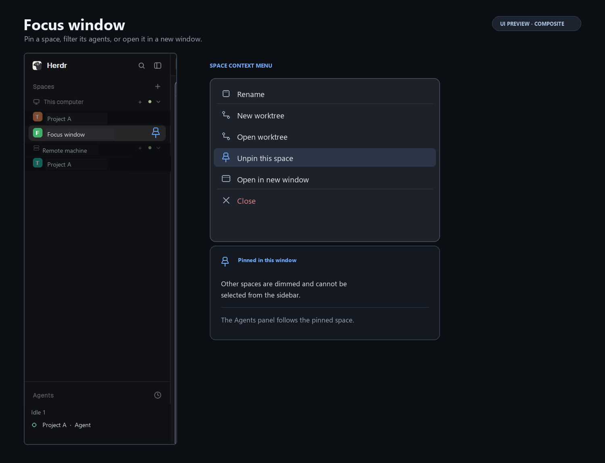

# Focus window

Focus window adds a window-local space pin to Herdr's Spaces sidebar. While pinned, only that space is selectable from the sidebar, and the Agents panel shows only agents in that space. The space context menu can also open a second Herdr window on the same space, with the same customization and without the Welcome screen.

The preview is a composite: it pairs a live sidebar capture with an illustrative open menu to show the pinned state and menu actions.

## What you see

The package customizes the stock main layout; it does not include a layout JSON. Keep the existing main layout's regions and sizes. In its left sidebar, replace the `spaces` block's mod with `focus-window` and the `agents` block's mod with `focus-agents`. The rest of the layout, including the tabs, active tab panes, status bar, and theme, stays as in the stock layout.

The Spaces panel keeps Herdr's machine headings, colored space rows, and worktree nesting. A pinned row gets a pin icon. While pinned, other rows are dimmed and cannot be selected or dragged to reorder from the sidebar. The compact sidebar rail also blocks selection of other spaces and offers the same space context menu.

The Agents panel retains Herdr's priority or grouped-by-space views, status indicators, agent pins, and expandable sub-agent trees. With a space pinned, it lists only agents in that space; with no space pinned, it shows all agents as usual.

## How it behaves

- Right-click a space and choose **Pin this space**. The window records that space's ID, selects it, and filters the Agents panel. Right-click that space again and choose **Unpin this space** to clear the pin and restore the full agent list.
- A pin is saved in this app home under shared key `space.pin`. Separate `HERDR_APP_HOME` directories therefore have independent pins. Startup does not discard the pin while the space list is still empty. This is a sidebar-only lock: keyboard shortcuts and commands such as `space.select`, `space.next`, and `space.prev` can still switch spaces.
- Right-click a space and choose **Open in new window** to start a Herdr process with a fresh app home, copy the customized `main-window` layout and the three mods into it, skip Welcome by copying `shared.json`, pin the chosen space in the new home, select it, and focus its first terminal pane in its active tab when one exists. The new app home has independent window and shared state after the copy; its pin is the space chosen from the menu.
- The other context-menu actions remain available: rename; Git worktree actions when the selected space is in a repository; and close. Existing drag-to-reorder behavior remains available when unpinned.
- Agent statuses retain the panel's existing presentation: **working** has an animated spinner, **blocked** shows “Needs you” (or a compact exclamation mark), **idle** is a ring, and **done** is a dot. Clicking an agent focuses its pane; clicking a sub-agent opens its terminal peek.
- There are no added keyboard bindings or hover-only actions.

## Built from

Install the three folders in `mods/` together. In a user-owned clone of Herdr's `main` layout, preserve the existing node tree and set the sidebar block content mods to `focus-window` and `focus-agents`. Save that layout as `layouts/main-window.json`; this exact filename is required by **Open in new window**. Keep the other shipped mod references from the cloned layout unchanged. The package intentionally contains no `layouts/` directory and no `keys.json`; no key changes are needed.

- `mods/focus-window/` is the Spaces sidebar. It groups spaces by machine, nests linked worktrees under their checkout, supports same-machine drag reordering, shows Git branch/ahead/behind details, and opens the `focus-menu` popup on right-click. It uses `spaces()`, `machines()`, `panes()`, `layout()`, `theme()`, shared state, and `run()` for space commands. It uses `hc(["machine", "ls", "--json"])`, `exec("git", ...)`, and `watchFolder()` to keep machine and repository details current.
- `mods/focus-menu/` provides the space context menu and delegates the existing pane/tab/global menus. Its **Pin this space** and **Unpin this space** actions store or clear `space.pin` with `setShared()`. Its **Open in new window** action runs a platform shell through `exec()`: PowerShell on Windows and `sh` elsewhere. That shell copies the configured layout, all three mods, and available settings files into a uniquely named app home, sets that home's `space.pin` to the chosen space, starts `herdr-app`, waits for the selected space's active tab to load, then runs `layout.switch`, `space.select`, and `pane.focus` on the active tab's first terminal pane when present. It verifies the selected space and pane focus before finishing.
- `mods/focus-agents/` is Herdr's Agents panel with one filter: it reads the same `space.pin` shared value and filters `agents()` by `agent.space`. It calls `setAgentOrder()` with the visible agents so `agent.next` and `agent.prev` follow the filtered list.
- Menu icons use Herdr's built-in `mods/workspace-chrome/` SVGs. Colors and status roles come from the active `theme()`.

The launcher expects `herdr-app` to be available on `PATH`, plus the platform shell (`powershell.exe` on Windows or `sh` on Unix-like systems). Git details require Git in the space's environment. The mods make no direct URL or `fetch()` requests; `hc` and `exec` use Herdr's configured machine connections.

## Watch out

- Install all three mod folders: the sidebar opens `focus-menu`, and the copied layout expects both `focus-window` and `focus-agents`.
- A fresh layout clone must be named `main-window` and present in the current app home. If it is absent or has different block mod names, the new window cannot reproduce this setup.
- Pinning does not intercept navigation outside the sidebar. It is not a security boundary or an app-wide space lock.
- **Open in new window** copies `shared.json` to carry the Welcome completion state and initial shared preferences. The new home is separate after launch; later changes do not synchronize.
- Focusing a terminal pane requires it to exist in the active tab. A tab with only mod panes has no terminal pane for `pane.focus`.
- Git details depend on local or remote Git availability. Offline remote machines may temporarily lack updated repository details.
- The package uses the `herdr` APIs and menu behavior available in Herdr 0.1.11-era cloned mods. It relies on the stock `main` layout and built-in `workspace-chrome` assets.

## Done when

- `herdr-app check` passes for each of `mods/focus-window`, `mods/focus-menu`, and `mods/focus-agents`.
- A cloned `main-window` layout renders the Spaces and Agents panels with the two mod references described above.
- Pinning a space selects it, dims and blocks other sidebar rows, and filters the Agents panel; unpinning restores the other rows and full agent list.
- The space menu still offers its existing actions and can open a new Herdr window on the selected space with the same customized layout and mods, pinned to that space and focused on its active tab's first terminal pane when present.
